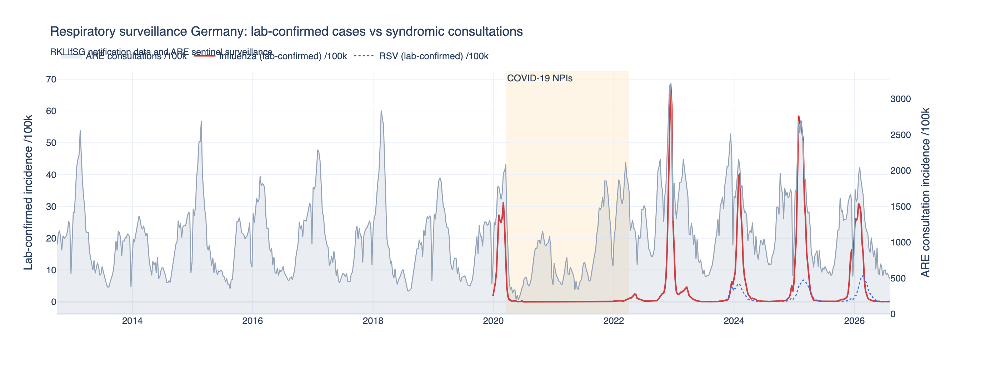
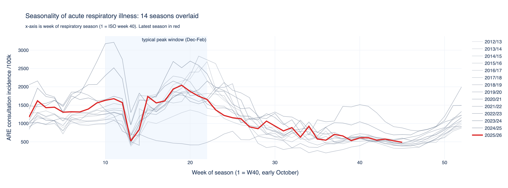
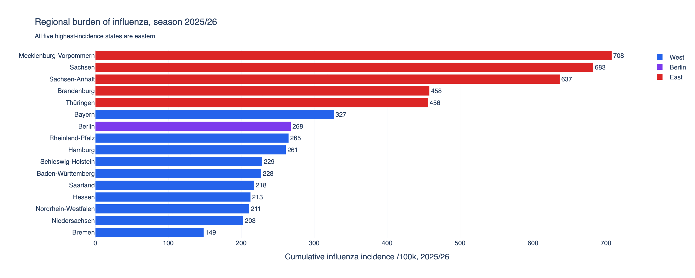
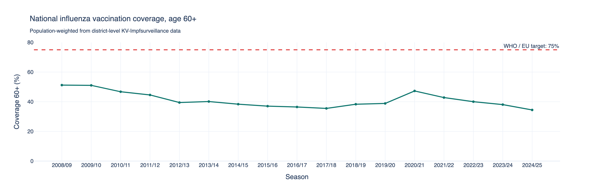
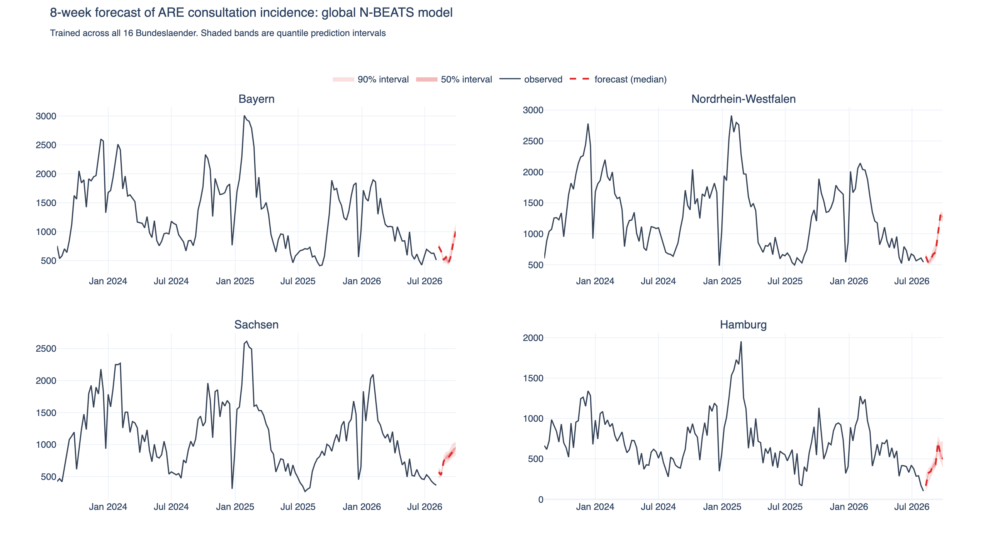

# Grippe-Surveillance Deutschland
## German influenza surveillance: from RKI notification data to a forecasting dashboard

-0F766E)

I built this to answer a question a German health authority actually has to answer every
autumn: how bad will this respiratory season be, where will it hit hardest, and can the
hospitals absorb it?

The pipeline pulls five live datasets from the Robert Koch-Institut, harmonises them,
checks them, forecasts eight weeks ahead, and writes out a star schema you can point
Power BI or Tableau at. Everything below ran against real data on 19 August 2026.

**DE:** Eine Ende-zu-Ende-Datenpipeline für fünf aktuelle Datensätze des Robert
Koch-Instituts: laborbestätigte Influenza- und RSV-Meldedaten, ARE-Konsultationsinzidenz,
Intensivkapazitäten und Impfquoten auf Kreisebene. Die Pipeline harmonisiert vier
inkompatible Regionalschlüssel-Systeme zu amtlichen AGS-Schlüsseln, prüft das Ergebnis mit
automatisierten Qualitätskontrollen und trainiert ein globales Deep-Learning-Modell
(N-BEATS, PyTorch) zur 8-Wochen-Prognose der Atemwegsinzidenz für alle 16 Bundesländer,
im direkten Vergleich mit einer saisonalen Naive-Baseline. Ergebnis ist ein dokumentiertes
Star-Schema für Power BI bzw. Tableau, mit DOI-referenzierter Datenherkunft und
DSGVO-Bewertung.

## Finding data that still exists

Most tutorials for German public health data are broken, so I checked every access route
before writing any code. As of 19 August 2026:

The ArcGIS `RKI_COVID19` REST service that nearly every 2021-era example calls was retired
along with the COVID-19 dashboard. SurvStat@RKI 2.0 holds the full notifiable-disease
archive but offers only a web UI and a registration-gated SOAP interface, so you cannot
automate it. Destatis GENESIS-Online moved off the `www-genesis` host, now requires POST
instead of GET, and rejects anonymous and `GAST` logins with `Code 15, not authorised` on
both `genesis.destatis.de` and `regionalstatistik.de`. It needs a free account, so I wired
it in as optional enrichment and the pipeline runs fine without it.

What does work is RKI's `robert-koch-institut` GitHub organisation: flat CSV and TSV files,
no auth, no rate limits, `datapackage.json` metadata, and a Zenodo DOI per release. All
five datasets below had been updated within the week before this run.

| Dataset | Resolution | Coverage | DOI |
|---|---|---|---|
| Laborbestätigte Influenzafälle (IfSG) | Bundesland × ISO week × age | 2020-W01 to 2026-W33 | [10.5281/zenodo.11276077](https://doi.org/10.5281/zenodo.11276077) |
| Respiratorische Synzytialvirusfälle (IfSG) | Bundesland × ISO week × age | 2023-W31 to 2026-W33 | [10.5281/zenodo.13240693](https://doi.org/10.5281/zenodo.13240693) |
| ARE-Konsultationsinzidenz | Bundesland × ISO week × age | 2012-W40 to 2026-W33 | [10.5281/zenodo.11235128](https://doi.org/10.5281/zenodo.11235128) |
| Intensivkapazitäten (DIVI-Intensivregister) | Bundesland × day | 2020-03-20 to present | [10.5281/zenodo.7676558](https://doi.org/10.5281/zenodo.7676558) |
| Impfquoten Erwachsene (KV-Impfsurveillance) | Kreis × season × age | 2008/09 to 2024/25 | [10.5281/zenodo.14742533](https://doi.org/10.5281/zenodo.14742533) |

All CC-BY 4.0, attributed to the Robert Koch-Institut.

## How the pipeline works

### Getting the data in

Each source is fetched with exponential-backoff retries, a local disk cache so re-runs cost
nothing, and a DOI fallback in the error message when a URL finally breaks. Every field is
read as a string first. If you let pandas infer types, the zero-padded regional key `'01'`
silently becomes the integer `1` and every downstream join quietly loses Schleswig-Holstein.
Each file gets SHA-256 hashed into `MANIFEST.json`, so any chart traces back to an exact
snapshot.

### Making 16 states line up

Four datasets, four ways of naming the same federal states. This was most of the work.

The ID columns disagree on width: IfSG pads to `'00'` through `'16'`, ARE does not, so it
ships `'0'` through `'16'`. The names disagree on umlauts: `Thüringen` in one file,
`Thueringen` in another. The national aggregate is called `Deutschland` in one place,
`Bundesweit` in another, and in the DIVI ICU data it does not exist at all, so I build it by
summing the underlying bed counts rather than averaging state rates.

The nastiest one is in the vaccination data. `Regionalschluessel_Kreis` arrives in three
widths: 4 characters for districts in states 01 to 09 (the leading zero is gone), 5 for
states 10 to 16, and 2 for rows that are not districts at all but state-level aggregates. A
reasonable-looking `zfill(5)` turns the Schleswig-Holstein aggregate `'01'` into district
`'00001'`, which does not exist, and folds every state total back into the district layer.
I split the layers before padding.

Everything resolves to the official 2-digit AGS (Amtlicher Gemeindeschlüssel) and joins on
that number, never on a name.

### Dates

Weeks are parsed as real ISO-8601 with `%G-W%V-%w`, which puts `2020-W01` in December 2019
where it belongs. ISO years have 52 or 53 weeks depending on the year, so `2021-W53` is a
label that cannot exist. The parser classifies every label before parsing and raises on an
invalid one rather than coercing it to `NaT`, because a coerced week gets dropped by the
next `dropna()` and you never find out you lost rows. Respiratory seasons run W40 to W39,
and `week_of_season` lets all 14 seasons sit on one axis.

### Missing values

Handled per column, never blanket-filled. The ICU emergency-reserve field is empty for the
first 2,192 rows because the field was introduced later, so it stays `NaN`: imputing zero
would invent capacity that nobody ever reported. The `Unbekannt` age group stays in the
fact table for completeness accounting but is excluded from any rate. Daily ICU data
aggregates to weeks by mean, since bed occupancy is a stock and not a flow, and partial
weeks at the series edges get dropped so they do not look like a capacity collapse.

### Population denominators

I recover population per state from RKI's own published figures rather than an external
table, using `population = cases / incidence × 100000` and taking the median across weeks
with at least 50 cases. The median absorbs the rounding in the published 2-decimal
incidence, and because it is the same denominator RKI used, recomputed rates reconcile with
the official ones instead of drifting by a percent. It cross-checks against Destatis if you
supply credentials. Derived values land within 0.1 to 2.6 percent across states.

### Quality checks

21 automated checks, all passing on this run: weekly-grid completeness, currency lag,
primary-key uniqueness, state totals reconciling against the published national row, age
bands summing to the reported total, and range validity on every rate. Results go to
`data_quality_report.csv`.

## Forecasting

The obvious target is lab-confirmed influenza. I did not use it, and that decision is the
part of this project I would most want to talk through in an interview.

The IfSG influenza series starts in 2020-W01. Two of its six seasons, 2020/21 and 2021/22,
were flattened by COVID-19 measures, when influenza very nearly vanished from Germany. A
seasonal model trained across that gap learns the average of a normal winter and no winter
at all, then under-forecasts every real peak. That is a structural break, not noise, and no
amount of tuning fixes it.

So the forecast target is ARE consultation incidence: 14 seasons back to 2012-W40, state
resolution, still updated weekly, and population-based rather than dependent on how much
each state happens to test. The pandemic period goes into the model as an explicit regime
covariate instead of being averaged away. Lab-confirmed influenza is still in the exports
as the clinical detail layer, and a config switch flips the target if you want it.

The model is a global N-BEATS (Darts on PyTorch) trained across all 16 states at once, so
each short series borrows seasonal shape from the other 15. Quantile regression gives the
prediction intervals. Evaluation is a rolling-origin backtest over a 78-week holdout with
`retrain=False`, against a seasonal-naive baseline.

| Model | MAE | RMSE |
|---|---|---|
| Seasonal naive (52w) | 318.41 | 406.51 |
| N-BEATS (global) | 319.60 | **375.88** |
| Naive drift | 1303.14 | 1397.57 |

N-BEATS ties the seasonal naive on MAE and beats it by 7.5 percent on RMSE, meaning it
makes fewer large misses even though its typical error is the same. With 14 seasons of
clean weekly data, a seasonal naive is genuinely hard to beat, and I would rather report
that honestly than tune until the deep model looks good. The comparison is in
`model_scores.csv` either way.

Training uses an A100. Being straight about it: 16 series over about 720 weeks is a small
problem by deep-learning standards, so the GPU turns minutes into seconds but is not the
bottleneck. Every other step runs on CPU.

## What the data shows

**Timing is predictable, size is not.** Across 14 seasons the ARE peak lands at a median of
week 20 of the season, usually February. Peak height varies several-fold. You can plan
staffing around when, not around how much.

**The pandemic left a two-season hole, then a rebound.** Lab-confirmed influenza fell to
near zero in 2020/21 and 2021/22, then came back early and hard in 2022/23. This is the
immunity-debt pattern, and the reason the forecast target is what it is.

**Regional variation is large, and partly an artefact.** Mecklenburg-Vorpommern reports
4.8 times the cumulative influenza incidence of Bremen (708 vs 149 per 100k in 2025/26),
and all five of the highest-incidence states are eastern. Since 2022/23 the eastern states average 49.1 percent
vaccination coverage in the over-60s against 37.1 percent in the west, yet also record 2.5
times the notification incidence. More prevention and more recorded disease at the same
time points at testing intensity rather than infection pressure. Pooled across state
seasons the correlation actually runs the other way (Spearman rho = -0.33), which is a neat
illustration of why you stratify before trusting an ecological correlation. If you build a
dashboard from these numbers, caption this.

**Vaccination coverage in the over-60s is well short of target.** 34.5 percent in 2024/25,
which is 40.5 points below the 75 percent WHO and EU Council target, with a persistent
north-east to south-west gradient.

**ICU occupancy is structural, not influenza-driven.** National occupancy sits at 81.5
percent and correlates only weakly with influenza incidence (r = 0.27). Staffing and
elective scheduling dominate. Presenting ICU load as a consequence of flu would overstate
the link.

## Selected output

Lab-confirmed influenza and RSV against syndromic consultation incidence. The shaded block
marks the COVID-19 intervention period, when influenza very nearly disappeared and the ARE
curve fell to a historic low.

Fourteen seasons on one axis, aligned on week of season. Timing clusters tightly, height
does not.

Four of the sixteen state-level forecasts, with 50 and 90 percent prediction intervals.
The model is picking up the usual autumn rise out of the summer trough.

## Data protection and GDPR

No personal data is processed here. Every input is aggregate statistics published by a
federal authority, with no patient-level record, no pseudonymised identifier and no
re-identification path, so personal data under GDPR Art. 4(1) is not in scope and no legal
basis under Art. 6 or Art. 9 is needed.

The upstream notifications arise under the Infektionsschutzgesetz, and RKI performs
aggregation and statistical disclosure control before anything is published. I respect the
small-number handling that comes with that: the pipeline makes no attempt to reconstruct
suppressed cells, and it never links datasets at a finer grain than the publisher released.
District-level vaccination data is aggregated upward to state level, never combined with
another source to narrow a cohort.

State-level associations between coverage and incidence are reported as ecological
correlations, not as individual vaccine effectiveness. Licence terms are honoured with
DOI-pinned provenance and per-file SHA-256 hashes, and the exports carry only the fields
the analysis needs.

## Dashboard

The story runs in three questions: where are we and what happens next, who is most
affected, and what can we act on.

1. **Choropleth of the 16 states** coloured by current-season cumulative incidence, with
   vaccination coverage in the tooltip. Join on `dim_region[iso_3166_2]`; boundaries from
   the [Bundesamt für Kartographie und Geodäsie](https://gdz.bkg.bund.de/).
2. **Time series with forecast band**, observed solid and forecast dashed with 50 and 90
   percent intervals from `lo80` and `hi80`. Driven by `vw_incidence_with_forecast`, split
   on `is_forecast`, so history and forecast share one axis with no union step in the BI
   tool.
3. **Seasonality heatmap**, `week_of_season` against `season`. Fourteen seasons readable at
   once, and the blank 2020/21 row tells the pandemic story without a single annotation.
4. **Coverage against target by state**, ranked with the 75 percent reference line, paired
   with ICU headroom KPI cards from `fact_icu_capacity`. This turns the analysis into a
   list of which states are furthest from target, and answers the obvious follow-up about
   whether the ICUs can cope.

## What is in this repo

| Path | Contents |
|---|---|
| `RKI_Influenza_Surveillance_Pipeline.ipynb` | The whole pipeline, with outputs and charts from the run described above |
| `rki_output/` | Star-schema exports (CSV and Parquet), quality report, model scores, charts, `MANIFEST.json`, static PNG charts plus interactive HTML versions |
| `rki_pipeline/` | The notebook is generated from `cells.txt` by `mk_nb.py`, which makes it reviewable as plain text |

The exports are a star schema rather than one wide sheet. `dim_region` and `dim_date` are
the dimensions; `fact_incidence`, `fact_icu_capacity`, `fact_vaccination` and
`fact_forecast` each sit at one grain, keyed on `ags` and `iso_week`. Relate the facts to
the two dimensions once and every visual works off the same model.

## Running it

Open the notebook in Google Colab, pick an A100 runtime, and run all. The data pipeline
takes about two minutes, GPU training roughly three more. Set `INSTALL_FORECAST = False` in
the first cell to skip the deep-learning install and run the data pipeline alone in about
15 seconds.

Outputs land in `rki_output/`, and the last cell bundles everything into a zip and
downloads it.

## Licence and attribution

Source data: Robert Koch-Institut, CC-BY 4.0, cited by DOI in the table above and hashed in
`MANIFEST.json`. Pipeline code: MIT.
